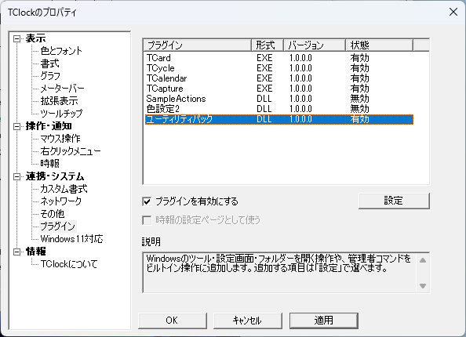
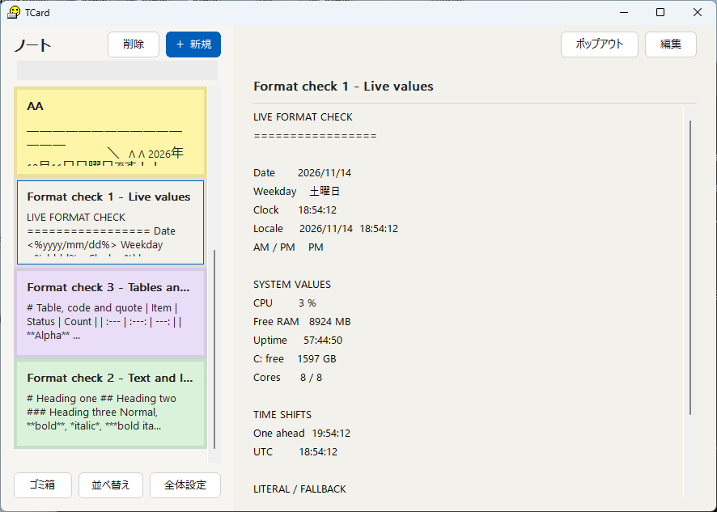
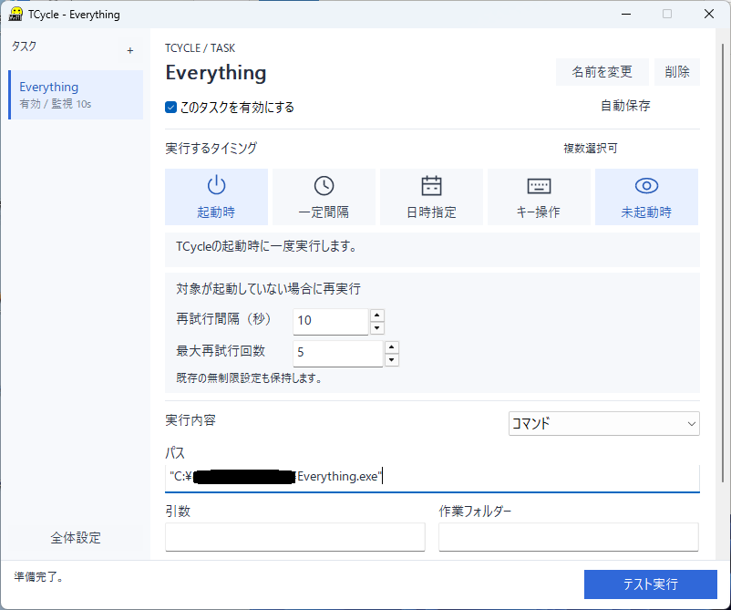
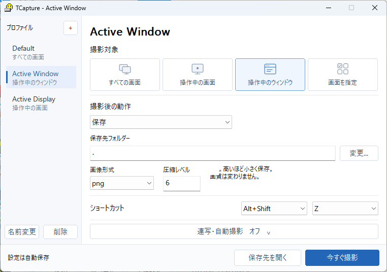
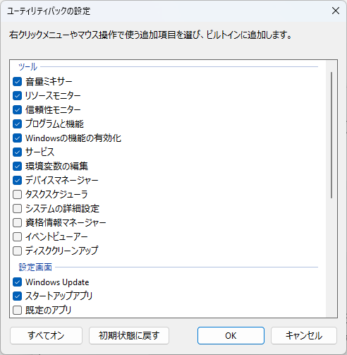

# TClock-Plugin

TClock本体から外した機能や、タスクバー時計の枠を超えるツールを、任意で追加できるプラグイン形式で配布します。

## ダウンロード

使いたいプラグインの ZIP を展開し、中身を TClock の `plugins` フォルダーにコピーしてください。（フォルダーがなければ作成してください。）追加したプラグインは、TClock の「プロパティ」→「拡張機能」から設定できます。

| プラグイン | ダウンロード |
|---|---|
| TCard（付箋・メモ） | [TCard.zip](https://github.com/dtguvdcu0/TClock-Plugin/releases/latest/download/TCard.zip) |
| TCycle（タスク自動実行） | [TCycle.zip](https://github.com/dtguvdcu0/TClock-Plugin/releases/latest/download/TCycle.zip) |
| TCapture（画面キャプチャ） | [TCapture.zip](https://github.com/dtguvdcu0/TClock-Plugin/releases/latest/download/TCapture.zip) |
| TCalendar（カレンダー） | 改装中 |
| UtilityPack（ユーティリティパック） | [UtilityPack.zip](https://github.com/dtguvdcu0/TClock-Plugin/releases/latest/download/UtilityPack.zip) |
| 色設定2 | [ColorSettings2.zip](https://github.com/dtguvdcu0/TClock-Plugin/releases/latest/download/ColorSettings2.zip) |

各プラグインの更新内容は [Releases](https://github.com/dtguvdcu0/TClock-Plugin/releases) で案内する予定です。

## TCard（付箋・メモ）

TClockの書式が使える付箋紙ツールです。単体で動作するほか、LAN内の他のPCと付箋を同期することもできます。

## TCycle（タスク自動実行）

Windowsのタスクスケジューラーのようなアプリケーションランチャーです。アプリの起動監視（終了時の再起動）、定期実行、キーボードショートカットからの起動などに対応しています。

## TCapture（画面キャプチャ）

マルチディスプレイ対応のスクリーンショットツールです。ホットキーでの撮影のほか、連続撮影や定期撮影もできます。

## TCalendar（カレンダー）

改装中

## UtilityPack（ユーティリティパック）

Windowsのツール・設定画面・フォルダーを開く操作や、管理者コマンドをビルトイン操作に追加します。追加する項目は「設定」で選べます。

## 色設定2

オミットした色設定2の設定画面をメニューに追加します。
